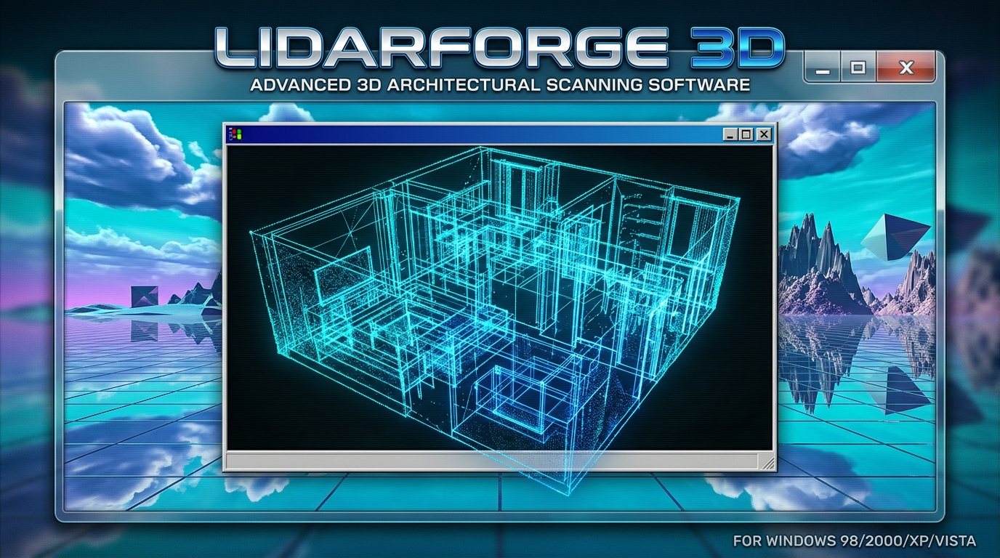
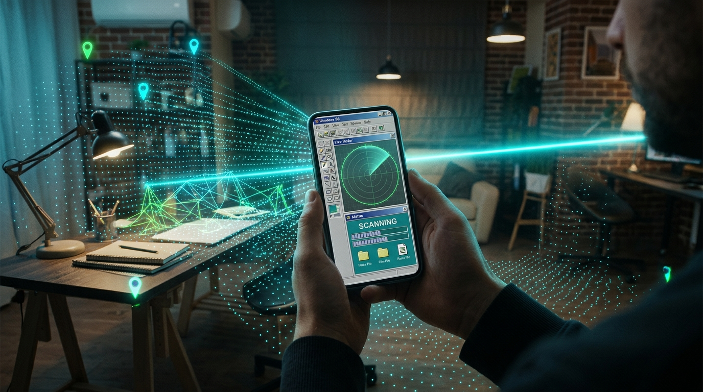
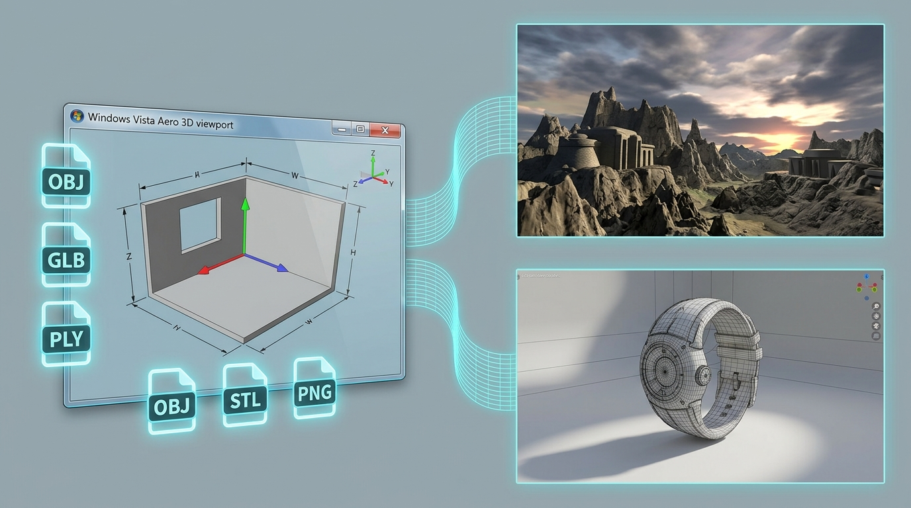

<div align="center">



# LidarForge 3D (`ScanTo3D`)

**Scan any real room with your Android phone and export ready-to-render 3D geometry for Bryce 3D, Blender, and VertexForge.**

[](https://github.com/ElizaBackrooms/ScanTo3D/releases/latest)
-3ddc84)
-0a7ea4)

</div>

---

## Releases & Trailer

- **Latest Release (`v4.0`):** View release notes and downloads at [**Release v4.0**](https://github.com/ElizaBackrooms/ScanTo3D/releases/tag/v4.0)
- **Launch Trailer (`1080p`):** Watch `LidarForge3D_Launch_Trailer.mp4` attached to [**Release v4.0**](https://github.com/ElizaBackrooms/ScanTo3D/releases/tag/v4.0)

---

## Features

- **Live ARCore Depth-from-Motion + IMU Scanner:** Fuses ARCore `DEPTH16` / CameraX RGB frames with 6-axis motion sensors, real-time triangulated mesh painting, a spinning mini-radar HUD, and manual **Corner Anchor** raycast pins.
- **Win98 ↔ Windows Vista Aero Workstation UI:** Classic desktop pull-down menus (`File`, `Edit`, `View`, `Export`), dropdown controls, Start menu unit switcher, and one-click toggling between **Windows 98** beveled chrome and glossy **Vista Aero** glass.
- **Interactive Post-Scan 3D Studio:**
  - Orbit, pinch-zoom, and snap to `ISO`, `TOP`, `FRONT`, or `SIDE` views.
  - Flip shading modes between **Shaded**, **Wire**, **Points**, and **Depth**.
  - Slice geometry in real time with the **3D Crop Box** (`X / Y / Z` axis sliders & quick presets).
  - Tune **Voxel Grid Resolution** (`4 cm – 24 cm`) with optional Laplacian surface smoothing.
  - **Tap-to-Measure** walls and corners in **Meters (`m`)**, **Feet / Inches (`ft`)**, or **Bryce Units (`BU`)**.
- **Built for Bryce 3D, Blender & VertexForge:**
  - Target presets automatically set up-axis and scale: **Bryce 3D (`Y-Up`, `4.096× BU`)** and **Blender (`Z-Up`, `1.0× Meters`)**.
  - Exports `.OBJ` (+ companion `.MTL` material groups), binary `.GLB` (glTF 2.0 with vertex RGB colors), `.PLY` point clouds/meshes, `.STL` meshes, and 16-bit/8-bit **Bryce Terrain Heightmap `.PNG`**.

---

## Showcase

| Live Spatial Scan | Multi-Format 3D Export |
| :---: | :---: |
|  |  |

---

## Privacy & Permissions

LidarForge 3D is **100% offline by design**:
- Only requests `android.permission.CAMERA` (for live ARCore / CameraX room capture).
- Requests **no `INTERNET` permission** — scans, meshes, and exports stay locally on your device until you share them via Android Share Sheet or Storage Access Framework (`SAF`).

---

## Building from Source

**Requirements:** JDK 21+ (or Android Studio / Google AI Studio), Android SDK (`compileSdk 36.1`, `minSdk 24`), Gradle `9.3.1`.

```bash
git clone https://github.com/ElizaBackrooms/ScanTo3D.git
cd ScanTo3D
gradle assembleDebug
```

The debug APK is written to `app/build/outputs/apk/debug/app-debug.apk`.
